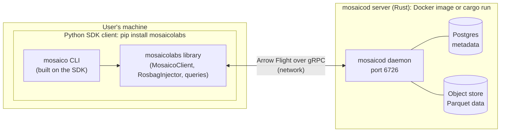
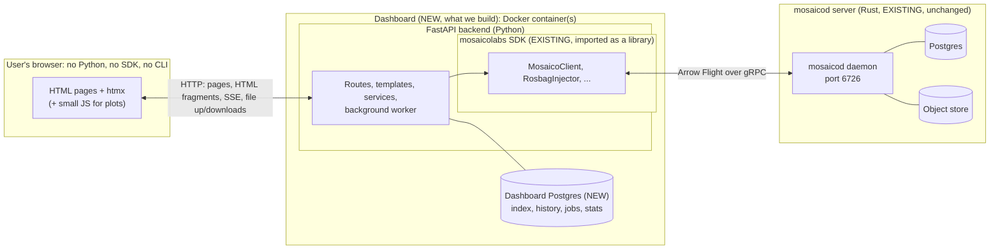

# Mosaico Dashboard — Build Plan (job-application prototype)

> Author: Abhishek Nannuri · Status: plan; execution tracked in `mosaico-dashboard/docs/BACKLOG.md` · Last updated: 2026-10-17
>
> Companion to `DASHBOARD_ROLE_PLAN.md` (the earlier, outreach-focused note). This document is
> the *engineering* plan: what to build, in what order, with which architecture, and why.
> Every claim about Mosaico below was checked against this repository (paths cited) unless it
> is explicitly marked **Assumption**.

---

## 0. TL;DR

- **Goal:** get hired for the Mosaico dashboard role by showing them, in a working demo, that I
  already think like the person they're looking for. The demo is the cover letter.
- **Scope:** ROS-first (rosbag `.mcap` / `.db3` / `.bag`, which the SDK already ingests via
  `RosbagInjector`). Read-heavy core plus **one** write path (upload a bag → watch it ingest).
- **Stack (mirrors the job description exactly):** FastAPI + Jinja2 + htmx, small islands of
  client-side JS only where needed (time-series plots), Postgres, Docker/Compose, GitHub Actions.
- **The non-obvious engineering:** the dashboard needs **its own catalog index + snapshot store**,
  because the daemon can't answer list/aggregate questions cheaply (§2). That index is the
  "BI layer" they mention in the role.
- **Deliverable:** a self-contained `mosaico-dashboard/` folder on my fork of the monorepo
  (§0.6), `docker compose up`, seeded with demo bags, a 3-minute
  screen recording, an architecture README, and 1 small upstream PR to `mosaico` (progress-callback
  hook, §6.4) to prove I can work in their codebase.
- **Outreach:** don't wait for permission to build; do send a short message + join their Discord
  once milestone M1 is running (≈ week 1), then follow up with the full demo (§10).

---

## 0.5 How Mosaico works today, and where the dashboard fits

### High-level picture

**Today (existing):** the user runs Python code or the CLI on their own machine.



**With the dashboard (new):** the user only has a browser. The SDK moves *inside* the dashboard
server.



Notes on the second diagram:
- The htmx UI **runs in the browser**, but its HTML is **generated and served by FastAPI**
  (Jinja2 templates). There's no separate frontend server or build.
- The browser never talks to mosaicod directly. Only the SDK inside the dashboard does.
- The dashboard has its **own** Postgres, separate from mosaicod's. Never write into
  mosaicod's database.

### The pieces (verified in this repo)

| Piece | What it is | Language | Where |
|---|---|---|---|
| **mosaicod** | A **server** (daemon). A separate long-running process, listening on a network port (default 6726). It stores data in Postgres (metadata) + S3-compatible object store (Parquet chunks). | Rust | `mosaicod/` |
| **Python SDK** (`mosaicolabs`) | A **client library**. Pure Python, **no Rust inside, no bindings**. It opens a network connection to mosaicod using `pyarrow.flight.FlightClient("grpc://host:6726")` (`comm/connection.py:169`) and wraps the raw protocol in friendly classes (`MosaicoClient`, `SequenceHandler`, `RosbagInjector`, query builders, ontology models like `IMU`, `Image`). | Python | `mosaico-sdk-py/src/mosaicolabs/` |
| **CLI** (`mosaicolabs_cli`) | A command-line tool built **on top of the SDK** (commands: `sequence`, `topic`, `profile`, …). Plus SDK scripts like `mosaicolabs.ros_injector` and `mosaicolabs.watchdog`. | Python | `mosaico-sdk-py/src/mosaicolabs_cli/` |

The relationship is client to server over a network, like `psycopg` (Python) talking to
PostgreSQL (C). The SDK does **not** ship or embed mosaicod; you run mosaicod separately
(Docker image `ghcr.io/mosaico-labs/mosaicod` or `cargo run`).

```text
TODAY
  Engineer's laptop / robot                         Server
  ┌──────────────────────────────┐                 ┌───────────────────────┐
  │ python script / Jupyter / CLI │                 │ mosaicod (Rust)       │
  │   └─ mosaicolabs SDK (Python) │ ── Arrow Flight │   ├─ Postgres         │
  │        └─ pyarrow.flight      │    over gRPC ──►│   └─ S3 object store  │
  └──────────────────────────────┘                 └───────────────────────┘
  Needs: Python, pip install, knowing the API, writing code.
```

### What "without requiring the SDK or the CLI" means

It's about the **end user**, not about how the dashboard is built internally. Today, to see
what's in Mosaico you must install Python, `pip install mosaicolabs`, and write code or run CLI
commands. An analyst or project lead won't do that. The dashboard gives them a **browser**
instead.

It does **not** mean "re-implement the SDK" or "talk to mosaicod without the SDK". The
dashboard **backend** is itself a Python program, so it simply **uses the SDK as a library**,
on the server side, invisible to the user:

```text
WITH THE DASHBOARD
  User's browser          Dashboard server (what we build)                      Server
  ┌───────────┐  HTTP    ┌──────────────────────────────────────────────┐     ┌──────────┐
  │ HTML+htmx │ ───────► │ FastAPI app                                  │     │ mosaicod │
  │ (no SDK,  │ ◄─────── │   ├─ routes / templates / services   (NEW)   │     │ (Rust,   │
  │  no CLI,  │          │   ├─ dashboard Postgres: index, history,     │     │ unchanged│
  │  no code) │          │   │   jobs, stats                    (NEW)   │     │ )        │
  └───────────┘          │   └─ mosaicolabs SDK (EXISTING, imported) ───┼────►│          │
                         └──────────────────────────────────────────────┘     └──────────┘
```

Doing it any other way (e.g. writing our own Arrow Flight client in the dashboard) would
duplicate thousands of lines of SDK code: protobuf actions, ontology decoding, image codecs,
ROS adapters. It would break whenever the wire protocol changes (it just did, commit
`77c0360`). Reusing the SDK is the "integration with mosaicod" the JD asks for, and the
mosaicod docs themselves describe the SDKs as the supported way in.

### Existing vs. new vs. changed

| Area | Already exists (reuse as-is) | New, built in the dashboard repo | Small change upstream (PR to `mosaico`) |
|---|---|---|---|
| Talking to mosaicod | SDK: `MosaicoClient`, handlers, query builders | A thin `MosaicoGateway` wrapper (runs blocking SDK calls in threads, timeouts, error → friendly message) | none |
| Catalog data (names, sizes, topics, sessions, time ranges, metadata, errors) | SDK reads all of it | Dashboard Postgres **index** synced by a worker, so pages can sort/filter/aggregate fast (SDK needs one network call per sequence) | none |
| Storage growth history | Daemon only knows **current** sizes | Daily **snapshot** tables (the dashboard's own data) + charts | none |
| ROS bag ingestion logic (read bag, convert ROS msgs to Mosaico ontology, upload) | SDK: `RosbagInjector`, ROS adapters | Upload form, file staging, job queue, worker that **calls** `RosbagInjector` | none |
| Ingestion **progress** | Exists, but only as a Rich **terminal** progress bar created inside `RosbagInjector.run()` | A "progress sink" that writes progress to the dashboard DB → pushed to the browser via SSE/htmx | **Yes, one small, optional PR:** let callers pass their own progress callback instead of the hard-coded terminal UI. Until merged, dashboard shows coarse status (queued/running/done/failed). |
| Sensor data for previews/export | SDK: `get_data_streamer(start, end)` | Downsampling, thumbnails, CSV/Parquet export endpoints, plots | none |
| Data model / BI layer | SDK models describe **what's in Mosaico** | Dashboard schema for **questions people ask** (growth, jobs, failures, metadata filters) | none |
| Users / login | mosaicod has **no users**, only global API keys | **Nothing**: single-user dashboard (ADR-0003). API keys stay server-side. | none |
| Deployment | mosaicod Dockerfile + devel compose | Dashboard Dockerfile, compose stack incl. mosaicod, CI | none |
| mosaicod (Rust) | Everything | none | **None.** We don't touch Rust. |

### On the progress hook specifically

Three options, and why the plan picks the first:

1. **Small SDK PR adding a progress-callback parameter** (recommended). ~50–100 lines,
   default behaviour unchanged, benefits every SDK user (Jupyter, other GUIs). It's also the
   "contribute to the open-source codebase" item from the JD.
2. Copy the injection loop into the dashboard and add progress there. That works without
   upstream approval, but forks ~300 lines of SDK logic that will drift. Acceptable only as a
   temporary fallback, clearly marked.
3. Monkeypatch `ProgressManager`. Fragile; don't.

In every option the **hook into htmx** (DB row → SSE endpoint → HTML fragment) lives in the
dashboard. The SDK only needs to *emit* progress events; it knows nothing about the web.

### Common misconceptions (and the correct picture)

| Misconception | Reality |
|---|---|
| "The SDK ships the Rust app with Python bindings" | No. SDK = pure-Python network client. mosaicod = separate server process. |
| "Dashboard must be standalone on mosaicod, without the SDK" | No. *Users* don't need the SDK; the dashboard *backend* uses it internally. |
| "We must re-implement the SDK in the dashboard backend" | No. Import it. Only add what the SDK doesn't do: web UI, index, history, jobs, stats. |
| "All modifications must live in the dashboard, not the SDK" | Almost all do. The single exception (progress callback) is better as a tiny upstream PR. |
| "The BI data model replaces the SDK's data models" | No. SDK models = the platform's catalog. Dashboard models = derived index + the dashboard's own history and jobs. Both coexist. |
| "Flask backend" | The JD says **FastAPI**, and the plan uses FastAPI. |
| "`pip install mosaicolabs` gives me the server too" | No. The pip package is **only Python**: the SDK, the `mosaico` CLI and scripts like `mosaicolabs.ros_injector` / `mosaicolabs.watchdog`. You **always** need a running mosaicod (Docker image `ghcr.io/mosaico-labs/mosaicod:<tag>` or built from `mosaicod/`) before the SDK can do anything. |

---

## 0.6 Where the code lives and how the dashboard gets the SDK

### Decision: a self-contained folder `mosaico-dashboard/` in my fork of the monorepo

```text
mosaico/                      ← my fork (branch AN/FastAPI_Dashboard)
├── mosaicod/                 ← Rust server (existing, untouched)
├── mosaico-sdk-py/           ← Python SDK (existing; only the optional progress-hook PR touches it)
├── mosaico-dashboard/        ← NEW: own pyproject.toml, own tests, own docs
├── docker/                   ← existing compose files (dashboard gets its own compose under mosaico-dashboard/)
└── docs/ …
```

Why a folder in the monorepo and not a separate repo:
- The README says the monorepo exists "to simplify the testing and reduce compatibility
  issues". The dashboard has exactly that problem: it needs SDK and daemon from the **same
  commit** (the wire protocol changed recently, `77c0360`). One repo = one commit = guaranteed
  compatible trio (daemon + SDK + dashboard), and CI can test them together.
- It matches how they already organise things (`mosaicod/`, `mosaico-sdk-py/` side by side).
  If they ever want it, the PR is "add a folder", not "merge a foreign repo".
- It's on my fork/branch, so it's **not** an unsolicited PR. I share the branch link.

"Self-contained" still applies, with rules:
1. `mosaico-dashboard/` has its **own** `pyproject.toml`, virtualenv, Dockerfile, tests and README.
2. It uses the SDK **only as an installed package**: `from mosaicolabs import MosaicoClient`.
   No `sys.path` hacks, no importing files by relative path, no copying SDK code.
3. It uses only the SDK's **public API** (whatever `mosaicolabs/__init__.py` exports), never
   `_private` helpers. If something's missing, that's a candidate SDK PR.

With those rules, extracting it to a separate repo later is a 10-minute job: replace the editable install
with a version pin.

### How the dashboard gets the SDK: dev vs. Docker vs. (later) release

The SDK is a normal Python package (`mosaico-sdk-py/pyproject.toml`, Poetry with the
`poetry-core>=2` build backend, which supports editable installs). So:

| Mode | When | How | Effect |
|---|---|---|---|
| **Development** | Day-to-day on my laptop | **Chosen:** `poetry install` for the dashboard's own deps, then `poetry run pip install -e ../mosaico-sdk-py` inside the dashboard's `.venv` (ADR-0002). `mosaicolabs` is *not* listed in the dashboard's `pyproject.toml`. | The dashboard imports the SDK from the local folder. **Edits to SDK files show up immediately**, no reinstall (only re-run `pip install -e` if the SDK's dependencies or entry points change). |
| **Docker / CI** | Building the dashboard image | Build context = repo root; install `./mosaico-sdk-py` **non-editable** into the image, then the dashboard | Image contains exactly the SDK from the same commit as the daemon tested in CI. |
| **Release / extracted repo** (later) | If shipped separately | `mosaicolabs = "==X.Y.Z"` from PyPI, where X.Y.Z matches the mosaicod image tag | Normal pinned dependency. |

I'll use **Poetry** for the dashboard as well, to match the SDK's tooling and the repo's
conventions (`poetry.toml` with `in-project = true` → `.venv` in the folder). The dashboard
gets its **own** `.venv`; don't reuse `mosaico-sdk-py/.venv`.

So the SDK-change workflow you described is right, and simpler than you feared:
1. Edit code in `mosaico-sdk-py/src/mosaicolabs/...` (e.g. add the progress callback).
2. Run the SDK's own tests (`mosaico-sdk-py`, `pytest`).
3. The dashboard (editable install) picks it up immediately; use the new parameter.
4. Upstream: open the SDK change as its **own small PR** against `mosaico` (`feat(py): …`),
   separate from any dashboard code.

### Running mosaicod during development

The pip/editable SDK needs a live daemon. In dev:
- `docker/devel/compose.yml` (upstream) is for **Rust** development: Postgres + S3 gateway only;
  mosaicod runs from `cargo run`. The dashboard doesn't use it.
- **`docker/devel/dashboard-compose.yml`** (D-01, ADR-0005) runs the built daemon
  (`mosaicod:local`: server, cleanup, store-optimizer) + Postgres 18 with filesystem storage in
  `mosaico-data/`, reusing the existing catalog volume. Profile `development` = daemon only
  (dashboard runs from the venv with hot reload); profile `production` = daemon + dashboard
  container.
- Rule: **SDK and daemon from the same commit.** Since the SDK is `0.8.0-dev` from `main`,
  don't pair it with `ghcr.io/mosaico-labs/mosaicod:latest` (a released version); build the
  daemon from this repo (`docker/dockerfiles/Dockerfile.mosaicod`) or `cargo run`.
- Later sprints add the dashboard database, the worker and a `demo` seed profile to the same
  compose file, so a reviewer runs **one** command.

---

## 1. What the job description is actually asking for

Reading between the lines of the posting:

| JD says | What it really means | How the prototype proves it |
|---|---|---|
| "non-technical users… don't think in topics and sequences" | The hard part is **translation**: vocabulary, units, defaults, what to show first. Not CRUD. | A domain-language layer: *Recording* (sequence), *Sensor stream* (topic), *Upload* (session), human-readable sizes/durations/rates, sensor-type icons from `ontology_tag`. |
| "browse sequences, monitor ingestion, track storage growth, transfer data" | Four named views. "Growth" implies **history**, which the daemon doesn't store. | Catalog explorer, ingestion monitor, storage analytics with a real growth chart (from snapshots), upload + export. |
| "htmx… server-rendered… rather than a heavy SPA" | They have an opinion. Respect it; don't show up with React. | Jinja2 + htmx everywhere; JS only for plots. Pages work without JS (progressive enhancement). |
| "high-frequency, multimodal… surface that data in ways that are immediately useful" | You can't ship 1 kHz IMU or 4K video to a browser. Need **server-side reduction**. | Downsampled previews (min/max-per-bucket), image thumbnails, GPS track, per-stream rate/coverage timeline. |
| "builds the software infrastructure that makes that possible" | Backend data plumbing, caching, background jobs, not just endpoints. | Catalog sync worker, Postgres-backed job queue, snapshot tables. |
| "owns how the application gets deployed and run in production" | Dockerfiles, CI/CD, config, health checks, observability. | Multi-stage non-root image, compose stack incl. mosaicod, CI pipeline, `/healthz` + `/readyz`, structured logs. |
| "Define the data model and query patterns that power the BI layer" | They expect a dashboard-owned schema (facts/dimensions), not just pass-through. | Explicit star-ish schema (§5) with documented query patterns. |
| "Contribute to the open-source codebase" | They want someone who'll send PRs to `mosaico`. | One small, well-scoped upstream PR (§6.4). |
| "Autonomous… drive technical decisions in a small team" | They want to see decisions *and the reasoning*. | A short decision log (ADR-style) in the repo (§7). |

**Bottom line:** the winning demo is not "lots of pages". It's *few pages that show judgment*:
correct data semantics, a sane architecture for the N+1 problem, realistic handling of big files,
and deployment that a team could actually run.

---

## 2. What the codebase tells us (constraints that shape the design)

Verified in this repo:

1. **Integration boundary = Python SDK over Arrow Flight/gRPC.** No REST API on `mosaicod`.
   The browser must never talk Flight; the dashboard backend wraps `mosaicolabs.MosaicoClient`.
2. **Listing is cheap, metadata is not (N+1).** `MosaicoClient.list_sequences()` returns names
   only (`comm/mosaico_client.py:744`). Size, sessions, topics and time range require a
   `get_flight_info` per sequence (`handlers/sequence_handler.py:122`). A catalog page with
   sorting/filtering by size or date over hundreds of recordings cannot call the daemon live.
   → **Dashboard needs its own index, refreshed in the background.**
3. **Available metadata (no data streaming needed):**
   - Sequence: `name`, `created_timestamp`, `user_metadata` (JSON), `total_size_bytes`, `sessions`,
     `timestamp_ns_min/max` (`models/platform/sequence.py`, `handlers/sequence_handler.py`).
   - Session: `locator`, `created_timestamp`, `completed_timestamp`, `locked`, `topics`
     (`models/platform/session.py`).
   - Topic: `ontology_tag`, `serialization_format`, `total_size_bytes`, `chunks_number`,
     `timestamp_ns_min/max`, `user_metadata`, `ontology_schema` (`handlers/topic_handler.py`).
   - Notifications per sequence/topic (errors during ingestion) (`comm/notifications.py`).
   - Server info (`MosaicoClient.info()`).
4. **Data retrieval supports time slicing:** `TopicHandler.get_data_streamer(start_ns, end_ns)`,
   so previews can fetch a small window instead of the whole topic.
5. **Rich query API exists:** `QuerySequence` (name glob, user_metadata, created time),
   `QueryTopic`, `QueryOntologyCatalog` (e.g. `IMU.Q.acceleration.x.gt(5)`). This powers an
   "advanced search" page later.
6. **ROS ingestion is a library call:** `RosbagInjector(ROSInjectionConfig(...)).run()`
   (`bridges/ros/injector.py`). **But progress reporting is hard-wired to a Rich terminal UI**
   (`ProgressManager` constructed inside `run()`, line ~417). → no per-message progress in a
   browser without a small SDK change (§6.4).
7. **Watchdog exists** (`watchdog/`): scans a folder, injects new bags, records
   loaded/quarantined state in text files. Good model for a "drop folder" ingestion mode.
8. **Sessions are immutable layers** (`docs/main/docs/daemon/ingestion.md`). An "upload" in the UI
   maps naturally to a session. A session with `completed_timestamp = None` and `locked = False`
   is the closest thing to "in progress" the daemon exposes.
9. **API keys are global and coarse** (`docs/main/docs/daemon/api_key.md`): `read`/`write`/`delete`
   across the whole platform. Dashboard user auth must be separate; the key stays server-side.
10. **SDK/daemon version coupling.** Commit `77c0360` switched wire payloads to protobuf. The SDK
    version used by the dashboard **must match** the daemon image. Pin both; don't mix PyPI SDK
    with a daemon built from `main`.
11. **Deletion is soft, then purged by `mosaicod cleanup`**; chunks get compacted by
    `store-optimizer`. Storage numbers can shift without user action. Worth a tooltip.

**Assumptions** (state them in the README, ask about them later):
- A1: one `mosaicod` instance per dashboard deployment.
- A2: catalog size in the hundreds to low thousands of sequences.
- A3: single-user dashboard, no accounts (ADR-0003). Shared deployments go behind an
  authenticating reverse proxy.
- A4: SDK calls are blocking (pyarrow Flight). Thread-safety of a shared `MosaicoClient` is
  **unverified**, so treat it as unsafe until tested (§6.2).

---

## 3. Product scope

### 3.1 Personas → questions the UI must answer in one click

| Persona | Questions |
|---|---|
| Data analyst | "Which recordings have a front camera and GPS from last week, at site X?" "Show me what the IMU looked like in this run." "Give me this slice as CSV/Parquet." |
| Project lead | "How much data did we collect this month? Is it growing faster than planned?" "Which projects use the most storage?" |
| Operations | "Did last night's uploads succeed? Which failed, and why?" "Upload this bag for me." |

### 3.2 Views, prioritised

| # | View | Priority | Contents |
|---|---|---|---|
| V1 | **Recordings (catalog explorer)** | P0 | Table: name, recorded date/duration, size, # sensor streams, sensor-type chips, key metadata columns. Search (name), filters (date range, sensor type, metadata key=value), sort, pagination. htmx live search. |
| V2 | **Recording detail** | P0 | Summary card (duration, size, created, metadata), **sensor stream list** (friendly type, rate Hz, size, coverage), **coverage timeline** (one bar per stream across the recording's time span → gaps visible instantly), uploads (sessions) list, notifications/errors. |
| V3 | **Sensor stream analytics** | P1 | Field list with types/dimensions; summary stats table (count, min, max, mean, std, nulls); per type: IMU / numeric → plot with mean line, ±std band, min/max envelope and hover values (§3.4); Image → thumbnail strip at N evenly spaced timestamps; GPS → track on map; others → schema + first rows table. |
| V4 | **Ingestion monitor** | P1 | Upload a bag (form, works without JS) → job queued → live status via SSE (queued → uploading → ingesting → done/failed, with topic-level progress once §6.4 lands). Job history with failures and the daemon's notifications. |
| V5 | **Storage analytics** | P1 | KPIs (total size, # recordings, 30-day growth), **growth over time** (from daily snapshots), top-N recordings, breakdown by sensor type and by a chosen metadata key (e.g. project). |
| V6 | **Data export** | P2 | Download a topic/time-window as CSV or Parquet (streamed, size-capped). |
| V7 | Advanced query | P3 | Form-builder over `QuerySequence` / `QueryOntologyCatalog`. Only if time allows. |

**Explicitly out of scope for the prototype** (mention them as "next steps" in the README):
multi-tenant authz, deletes from the UI, video playback, 3D point-cloud viewer, MCAP-non-ROS
(protobuf/jsonschema) bridges, a full BI query builder.

### 3.3 Vocabulary layer (small thing, big signal)

| Platform term | UI term | Note |
|---|---|---|
| Sequence | Recording | |
| Topic | Sensor stream | Show ROS topic path as secondary text for engineers. |
| Session | Upload / data layer | |
| `ontology_tag` | Sensor type + icon | Map `imu`, `image`, `gps`, `camera`, … → "Motion sensor (IMU)", "Camera", "GPS". Unknown → "Other". |
| `timestamp_ns_*` | Start / end / duration | Local timezone, relative ("3 days ago") + absolute on hover. |
| `total_size_bytes` | "4.2 GB" | |
| msg count / duration | "≈ 200 Hz" | **Verify** cheapest source of msg count (reader exposes `msg_count`; check whether it requires opening a stream). If expensive, compute during sync, not per request. |

### 3.4 Who sees what: analytics first, operations second, developer knobs never

The JD audience is non-technical, so the dashboard is **an analytics and operations tool, not
an SDK in a browser**. Three layers:

| Layer | For | What's in it | What's **not** in it |
|---|---|---|---|
| **1. Overview** | Everyone | Recordings list, search/filters, recording summary, coverage timeline, storage KPIs and growth | Topic paths, ontology names, nanoseconds |
| **2. Analytics drill-down** | Analysts, leads | Per-stream: field list with data types and dimensions, **summary stats** (count, min, max, mean, std, null/NaN), plot with **mean line + ±std band + min/max envelope**, overall min/max as reference lines, **hover tooltip** with exact values, drag-to-zoom, export of the selected window | Arbitrary code or query languages |
| **3. Operations** | Ops staff | **Upload a ROS bag** (`.mcap`/`.db3`/`.bag`): pick file, name it, optional metadata fields, then watch status; job history and failure reasons | SDK-level knobs: adapter overrides, custom message definitions, error policies, topic-level policies. Those stay in the SDK/CLI. A collapsed "Advanced" panel may offer just ROS distro and a topic filter. |

So the answer to "developer features or analytics?": **analytics plus simple operations**.
Uploading a bag counts as operations ("transfer data" / "monitor ingestion" in the JD), but
presented as a file upload, not as an injector configuration screen.

How the stats are produced (verified in this repo): mosaicod stores **per-chunk min/max** per
numeric column (`column_chunk_numeric_t` in `mosaicod/crates/mosaicod-db/migrations/`) but only
to prune queries. The SDK doesn't expose it, and **mean/std aren't stored anywhere**. So:
- **Whole-stream stats:** computed once by the dashboard worker by streaming the topic chunk by
  chunk (Welford's algorithm, constant memory), stored in `stream_field_stats`, recomputed only
  when the stream changes.
- **Plot buckets:** computed on request for the visible time window (`get_data_streamer(start,
  end)`), per bucket `min/max/mean/std/count`, so 200 Hz × 1 h becomes ~800 points.

---

## 4. Architecture

```
Browser (HTML + htmx, tiny JS islands for plots)
   │  HTTP (full pages / HTML fragments / SSE / file streams)
   ▼
dashboard-web  (FastAPI, Jinja2)          dashboard-worker (same codebase, different entrypoint)
   │  routes → services → repositories       │  catalog sync · storage snapshots · ingestion jobs
   │                └─→ MosaicoGateway ──────┤
   ▼                                         ▼
dashboard Postgres (index, snapshots, jobs, stats)        mosaicod  (Arrow Flight / gRPC)
                                                              │
                                                     mosaicod Postgres + object store (S3)
```

Key principles:

1. **Daemon is the source of truth; dashboard DB is a derived index + history.** Never copy raw
   sensor payloads into the dashboard DB. Everything in it can be rebuilt by a full resync
   (except snapshots and job history, which are the dashboard's own facts).
2. **One gateway, one place where the SDK is touched.** `MosaicoGateway` is a `Protocol` with a
   real implementation (SDK) and a fake (tests). Route handlers never import `mosaicolabs`.
3. **Web process never does heavy work.** Ingestion, sync, and snapshotting run in the worker.
   Web only enqueues and reads state.
4. **Read path for catalog = dashboard DB** (fast, sortable, filterable). **Read path for
   previews/export = live from daemon** (time-sliced, downsampled, cached briefly).
5. **Honest freshness.** Every catalog page shows "synced 40 s ago"; a "refresh now" button
   enqueues a sync for that recording.

### 4.1 Folder layout (`mosaico-dashboard/` inside the monorepo fork, see §0.6)

> Superseded by `mosaico-dashboard/docs/architecture.md` (current structure) and ADR-0006.
> The tree below is the original sketch.

```text
mosaico-dashboard/
├── pyproject.toml              # Poetry (SDK added via `pip install -e ../mosaico-sdk-py`, ADR-0002); ruff, pytest, pyright
├── poetry.toml                 # in-project = true (own .venv, like the SDK)
│                               # Dockerfile → ../docker/dockerfiles/Dockerfile.mosaico-dashboard
│                               # compose    → ../docker/devel/dashboard-compose.yml
├── compose.override.example.yml
├── .github/workflows/ci.yml
├── docs/
│   ├── architecture.md         # the diagram above + data flow per view
│   └── decisions/              # ADR-0001 … (see §7)
├── scripts/
│   ├── make_demo_bags.py       # deterministic synthetic ROS2 bags (IMU, GPS, image, odom) via `rosbags`
│   └── seed.sh                 # ingest demo bags, backfill snapshots
├── migrations/                 # alembic
├── src/dashboard/
│   ├── main.py                 # app factory, lifespan (gateway, db pool, templates)
│   ├── settings.py             # pydantic-settings; MOSAICO_HOST/PORT/API_KEY/TLS, DATABASE_URL…
│   ├── logging.py              # structlog JSON, request-id middleware
│   ├── domain/                 # pure Python: models, vocabulary mapping, formatting, downsampling
│   │   ├── models.py           # Recording, SensorStream, Upload, IngestionJob, StorageSnapshot
│   │   ├── vocabulary.py       # ontology_tag → label/icon; units
│   │   └── downsample.py       # min/max-per-bucket (and LTTB) with numpy/polars
│   ├── gateway/
│   │   ├── base.py             # MosaicoGateway Protocol
│   │   ├── sdk.py              # real impl: wraps MosaicoClient, thread offloading, limiter, timeouts
│   │   └── fake.py             # in-memory impl for tests and UI work without a daemon
│   ├── db/                     # SQLAlchemy 2.0 async (or psycopg 3) tables + repositories
│   ├── services/               # catalog, recording, preview, ingestion, storage, export
│   ├── jobs/                   # postgres queue (SKIP LOCKED), handlers, scheduler
│   ├── web/
│   │   ├── deps.py             # DI: get_gateway, get_db, current_user
│   │   ├── htmx.py             # is_htmx(request), render page-or-fragment helper
│   │   ├── routes/             # recordings.py, ingestion.py, storage.py, export.py, health.py, api.py
│   │   ├── templates/          # base.html, pages/, partials/ (fragments rendered by htmx)
│   │   └── static/             # htmx.min.js (vendored, pinned), css, plot.js island
│   └── worker.py               # worker entrypoint
└── tests/
    ├── unit/                   # domain + services against FakeGateway
    ├── web/                    # TestClient: full page vs HX-Request fragment, status codes
    └── integration/            # docker compose: real mosaicod + demo bag → assertions
```

### 4.2 Request flow examples

- **Recordings list, user types in search box:** `<input hx-get="/recordings" hx-trigger="input
  changed delay:300ms" hx-target="#results" hx-push-url="true">` → route sees `HX-Request` →
  renders only `partials/recordings_table.html` from **dashboard DB**. Without JS, the same
  URL renders the full page (plain GET form). Same handler, same query params.
- **Recording detail:** dashboard DB for summary + streams; notifications fetched live (cheap)
  with `hx-trigger="load"` so the page paints immediately.
- **IMU preview:** `GET /recordings/{r}/streams/{topic}/preview?from=&to=&width=800` → gateway
  streams the window in a thread → `downsample.minmax(buckets=width)` → returns JSON (~1.6k
  points) consumed by a uPlot island. Cached (LRU/TTL, keyed by args) since data is immutable.
- **Upload:** form POST (multipart, streamed to a staging volume, size-capped) → insert
  `ingestion_job(status=queued)` → redirect to `/ingestion/{job}` → page subscribes via
  `hx-ext="sse"` to `/ingestion/{job}/events` → worker updates job rows → SSE endpoint pushes
  re-rendered status fragments.

---

## 5. Data model (the "BI layer")

Dashboard-owned Postgres. Dimension-ish tables are a **derived index** of daemon state. Fact
tables are the **dashboard's own history**.

```sql
-- Dimensions (rebuilt by sync)
recording (
  name text primary key,
  created_at timestamptz not null,
  data_start timestamptz, data_end timestamptz,          -- from timestamp_ns_min/max
  total_size_bytes bigint not null,
  user_metadata jsonb not null default '{}',             -- GIN index for key/value filters
  stream_count int not null, session_count int not null,
  has_errors boolean not null default false,
  synced_at timestamptz not null, sync_hash text         -- skip rewrite if unchanged
);
sensor_stream (
  recording_name text references recording on delete cascade,
  topic text, ontology_tag text, serialization_format text,
  total_size_bytes bigint, chunks int,
  data_start timestamptz, data_end timestamptz,
  msg_count bigint null,                                 -- if cheaply available
  user_metadata jsonb,
  primary key (recording_name, topic)
);
upload_session (
  locator text primary key, recording_name text references recording on delete cascade,
  started_at timestamptz, completed_at timestamptz null, locked boolean, topics text[]
);

-- Facts (dashboard's own history; NOT rebuildable — back these up)
storage_snapshot_daily (
  day date, recording_name text, ontology_tag text,
  size_bytes bigint, stream_count int,
  primary key (day, recording_name, ontology_tag)
);
ingestion_job (
  id uuid primary key, source text,                      -- 'upload' | 'watch_folder'
  file_name text, file_size_bytes bigint, sequence_name text,
  status text,                                           -- queued|running|succeeded|failed|cancelled
  progress jsonb,                                        -- per-topic counts once SDK hook exists
  error text,
  queued_at timestamptz, started_at timestamptz, finished_at timestamptz,
  attempts int default 0
);
ingestion_event (job_id uuid, at timestamptz, level text, message text);
stream_field_stats (                                     -- per numeric field, computed by the worker
  recording_name text, topic text, field text,
  count bigint, min double precision, max double precision,
  mean double precision, std double precision, null_count bigint, nan_count bigint,
  computed_at timestamptz,
  primary key (recording_name, topic, field)
);
-- No users table: single-user dashboard (ADR-0003).
```

**Query patterns this enables** (each is one indexed SQL query, not N daemon calls):
- Catalog: filter by name ILIKE / date range / `ontology_tag IN` (via EXISTS on sensor_stream) /
  `user_metadata @> '{"project":"apollo"}'`; sort by size/date; keyset pagination.
- Growth: `sum(size_bytes) group by day` (+ by `ontology_tag` or `user_metadata->>'project'`).
- Ops: jobs by status in last 24 h, failure rate, median duration, throughput (bytes/s).
- Distinct metadata keys/values (for auto-generated filter dropdowns): `jsonb_object_keys`
  over `recording.user_metadata`. This is how non-technical users get filters without
  knowing the metadata schema.

**Sync strategy** (worker):
1. Every N seconds: `list_sequences()`; diff against `recording.name` set.
2. New/unknown or recently changed → fetch handler metadata (bounded concurrency, e.g. 4).
3. Removed → delete rows (cascade).
4. Periodic full re-verify (e.g. hourly) to catch session additions to old recordings.
5. Ingestion jobs trigger an immediate targeted sync of their sequence on completion.
6. Daily (and at startup if missing): write `storage_snapshot_daily` from current index.
   For the demo, `seed.sh` backfills synthetic history so the growth chart isn't empty, **and
   the UI labels backfilled points as such** (honesty matters here).

---

## 6. Key technical decisions in detail

### 6.1 Frontend: htmx-first, islands for reactivity
- Jinja2 templates; one `render(request, page, fragment, ctx)` helper that returns the fragment
  for `HX-Request` and the full page otherwise (also handle `HX-History-Restore-Request`).
  Consider `jinja2-fragments` to render a block from the page template, so there's no duplication.
- `hx-boost` on nav for SPA-like feel with real URLs; `hx-push-url` on filters, so URLs are
  shareable ("send me that filtered list").
- SSE (htmx `sse` extension) for ingestion progress; polling (`hx-trigger="every 5s"`) only for
  low-value refreshes, and stop it when the job is terminal (return `HX-Trigger`/286).
- **JS islands:** uPlot for time series (tiny, fast with 10⁵ points); Leaflet for GPS **with a
  configurable tile URL** (robotics sites are often offline, so fall back to a plain SVG track).
  No bundler; vendored, version-pinned files. Alpine.js only if a widget truly needs local state.
- CSS: hand-rolled with CSS variables (or Pico.css) + dark mode. Accessible tables, keyboard nav.

### 6.2 Calling a blocking SDK from async FastAPI
- All gateway calls go through `anyio.to_thread.run_sync` with a **CapacityLimiter** (e.g. 8),
  plus a timeout. This protects the event loop and the daemon.
- **Verify early (day 1 spike):** is one `MosaicoClient` safe to share across threads? It caches
  handlers (`clear_sequence_handlers_cache`). If not safe → small pool of clients (queue of N
  connected clients, checked out per call). Document the finding in an ADR.
- Streaming previews/exports: iterate `TopicDataStreamer` in a thread, push chunks through an
  `anyio` memory stream into `StreamingResponse`; always `close()` the streamer (single active
  streamer per handler, `topic_handler.py:305`).

### 6.3 Background jobs: Postgres queue, not Celery/Redis
- `SELECT … FOR UPDATE SKIP LOCKED` on `ingestion_job`; LISTEN/NOTIFY to wake the worker.
- Why: the JD says "lean stack". Postgres is already required; no Redis/broker to run.
  Alternatives considered: Celery (heavy), arq/RQ (needs Redis), FastAPI BackgroundTasks
  (dies with the web process, no retries). ADR it.
- Ingestion runs `RosbagInjector` in a **subprocess** per job (memory isolation for big bags,
  clean cancellation by killing the process, no Rich console pollution). Progress via §6.4.
- Retry policy mirrors the Watchdog's `RAISE/RETRY/QUARANTINE` semantics to stay consistent
  with the SDK's vocabulary.

### 6.4 Upstream contribution: injector progress hook
- Today: `ProgressManager` (Rich) is created inside `RosbagInjector.run()`.
- Proposal (small PR to `mosaico-sdk-py`): define a `ProgressSink` protocol
  (`on_start(topics, totals)`, `on_advance(topic, n)`, `on_topic_status(topic, status)`,
  `on_finish(status)`); default implementation = existing Rich UI; injectable via config.
  Same hook for the MCAP injector.
- Dashboard implements a sink that writes throttled progress (e.g. every 500 ms) to
  `ingestion_job.progress`.
- **Process (per `CONTRIBUTING.md`):** Mosaico does **not** accept PRs from non-approved
  contributors; they're closed unreviewed. So: open a GitHub **Discussion** describing the use
  case → ask to be onboarded (foss@mosaico.dev) → only then issue + PR (conventional-commit
  title like `feat(py): …`). Until then the hook lives on the fork and is shown in the demo as a
  proposal. That's still a good interview story.
- Until merged: show coarse states only (queued/running/succeeded/failed + notifications), and
  say so in the UI. Don't monkeypatch the SDK.

### 6.5 Large file upload
- Prototype: streamed multipart to a staging volume (never buffer in memory), hard size cap,
  checksum, cleanup on success/failure (a periodic sweeper also deletes orphaned staged files).
- Production path (documented, not built): resumable uploads (tus protocol) or presigned
  upload directly to object storage, then the worker uses the Watchdog's `ObjectStoreFileSource`
  pattern (`watchdog/file_source.py`). Also: a "watch folder" mode = run the Watchdog logic as a
  worker job source, so robots/NAS drops show up in the same ingestion monitor.

### 6.6 High-frequency data → useful visuals
- **Min/max per pixel-bucket** downsampling for line plots (preserves spikes, which matter
  for anomaly spotting; plain averaging hides them). LTTB as an option.
- Image streams: sample K timestamps evenly across the range, fetch the nearest message each,
  encode to small JPEG thumbnails, cache on disk.
- Coverage timeline: computed from per-stream `data_start/data_end` (cheap). Later, true gap
  detection would need per-chunk stats, so mark as a future daemon/SDK capability question.
- Polars for windowed aggregation (fast, also listed in the JD's nice-to-haves).

### 6.7 Security (single-user, but correct boundaries)
- Mosaico API key: env/secret only; never in templates, logs, or image. Use a `read` key for
  web and a `read|write` key **only** in the worker (principle of least privilege; keys are
  global, so splitting by process is the only lever).
- No dashboard accounts (ADR-0003). Bind to `127.0.0.1` by default; for a shared deployment
  put it behind a reverse proxy that authenticates. Accounts/OIDC are in the icebox.
- Export endpoints: size/time-window caps to avoid accidental multi-GB pulls.

### 6.8 Deployment & operations
- **Dockerfile:** multi-stage, built with the repo root as context so it can install
  `./mosaico-sdk-py` (build wheels → slim runtime), non-root UID, `tini`,
  `HEALTHCHECK`, `CMD` switchable `web|worker|migrate`. Pin SDK to the daemon's version.
- **Compose:** `docker/devel/dashboard-compose.yml` with profiles `development` / `production`
  (ADR-0005); later adds dashboard DB init, a one-shot migrate, the worker and a `demo` seed profile.
- **Config:** `pydantic-settings`, 12-factor, `.env.example` documented.
- **Health:** `/healthz` (process alive), `/readyz` (DB reachable + `gateway.info()` within
  timeout). Header shows daemon connection status.
- **Observability:** structlog JSON with request id; Prometheus `/metrics` (request latency,
  gateway call latency/errors, job durations, sync lag). Stretch goal.
- **CI (GitHub Actions):** ruff + pyright + pytest (unit/web) → build image → compose-based
  integration test with a demo bag → push to GHCR on tag. Optional: deploy demo to a small VM
  (Fly.io/Hetzner) for a clickable public link (read-only demo user, synthetic data only).

### 6.9 Testing strategy
- Unit: domain (vocabulary, downsampling, formatting) and services against `FakeGateway`.
- Web: each route renders full page vs fragment correctly; 404 for missing recording; error
  states render (daemon down → friendly banner, not a traceback).
- Integration: compose stack, ingest `make_demo_bags.py` output, run sync, assert catalog rows,
  preview endpoint returns ≤ width*2 points, upload job reaches `succeeded`.
- Optional: one Playwright test for the htmx search + upload flow.

---

## 7. Decision log (to become `docs/decisions/ADR-*.md`)

| # | Decision | Why | Rejected alternatives |
|---|---|---|---|
| 1 | Self-contained `mosaico-dashboard/` folder in my monorepo fork; SDK consumed as an (editable) installed package via its public API | Follows their monorepo rationale (daemon + SDK + dashboard compatible at one commit, tested together); no unsolicited PR since it lives on my fork; trivially extractable | Separate repo pinned to PyPI (version-drift risk with `main`); importing SDK files by path (not standalone) |
| 2 | Server-rendered + htmx, JS islands | JD preference; less state, fewer bugs, shareable URLs | React/Vue SPA |
| 3 | Dashboard-owned catalog index | N+1 metadata fetch (§2.2); need sort/filter/aggregate | Live daemon calls per page (slow), in-memory cache only (no history) |
| 4 | Snapshots for growth | Daemon stores current state only | Inferring growth from `created_timestamp` (wrong once deletes/compaction happen; still useful as a fallback "ingested per day" chart) |
| 5 | Postgres job queue | Lean stack, transactional with job state | Celery/Redis, BackgroundTasks |
| 6 | Ingestion in subprocess | Memory isolation, cancellation | In-thread in worker |
| 7 | Min/max downsampling server-side | Preserves peaks; bounded payload | Ship raw data, average-based |
| 8 | Split API keys web/worker | Keys are global and coarse | One read/write key everywhere |
| 9 | ROS-first | SDK's most mature bridge; robotics audience; demo bags easy to synthesize | MCAP protobuf/jsonschema first |

---

## 8. Milestones (each ends with something demoable, so you can stop and apply at any point)

Estimates assume ~3–4 focused hours/day.

**M0 — Spike & foundations (2–3 days)**
- Run devel stack, ingest demo bags (local data already exists in `mosaico-data/`).
- Spike script: time `list_sequences` + handler metadata for all sequences; test client
  thread-safety; check how to get `msg_count` cheaply. Write findings into ADR-3 / §6.2.
- Repo skeleton, settings, logging, app factory, base template, `/healthz`, `/readyz`,
  Dockerfile, compose, CI (lint + tests). `make_demo_bags.py` with IMU/GPS/Image/Odometry.
- ✅ Demo: `docker compose up` → empty but styled dashboard showing "Connected to mosaicod vX".

**M1 — Catalog explorer + recording detail (4–5 days)** ← *send first outreach message here*
- DB schema + migrations, sync worker, Recordings list (search, filters, sort, pagination,
  metadata-key filters), Recording detail (streams, sessions, notifications, coverage timeline),
  vocabulary layer, freshness indicator.
- ✅ Demo: find "recordings with GPS from last week" in 2 clicks; see gaps in a recording.

**M2 — Ingestion monitor (4–5 days)**
- Upload form, staging, job queue, subprocess runner, SSE status page, job history,
  failure details (exception + daemon notifications), retry button.
- Open the SDK issue/PR for the progress hook (§6.4) in parallel.
- ✅ Demo: upload a bag in the browser and watch it become a recording.

**M3 — Storage analytics (2–3 days)**
- Daily snapshots, backfill script, KPIs, growth chart, breakdowns by sensor type / metadata key,
  top-N.
- ✅ Demo: "we grew 120 GB in 30 days, 70% is camera data, project X is the biggest consumer."

**M4 — Sensor previews + export (4–5 days)**
- IMU/numeric plot with range selection (re-fetch at higher resolution on zoom), image
  thumbnail strip, GPS track; CSV/Parquet export of a window.
- ✅ Demo: a project lead sees a spike in IMU at 02:14 and downloads that 10-second slice.

**M5 — Polish & package (2–3 days)**
- Error/empty/loading states everywhere, a11y pass, README with screenshots,
  architecture doc, ADRs, 3-min video, optional public read-only deployment.

Total ≈ 3–4 weeks part-time. **Minimum viable application = M0 + M1 + README + video.**

---

## 9. Risks & unknowns

| Risk | Mitigation |
|---|---|
| SDK not thread-safe | Client pool; bounded limiter; covered in spike |
| `msg_count`/rates expensive | Compute in sync worker once; or omit and show duration + size |
| SDK/daemon version drift (protobuf wire change) | Pin both to the same tag in compose and `pyproject` |
| Large bags overwhelm demo VM | Size cap on upload; synthetic demo bags are small |
| Company already has an internal dashboard | Fine: the demo still shows thinking. Frame it as "how I'd approach it", not "use this". |
| Over-building before any feedback | Outreach at M1; scope cuts are pre-decided (P2/P3 droppable) |
| Branding/legal | Name it "unofficial prototype", no Mosaico logo as product branding, Apache-2.0, credit the SDK |

---

## 10. Outreach plan

Answering the question directly: yes, build first. A working demo is the strongest signal for this
role. But **don't stay silent for a month**; a short message after M1 costs nothing and could
surface information that changes the plan (e.g. "we already have X, focus on Y").

1. **Now:** join their Discord (linked in `README.md`), lurk, read issues/PRs to learn the
   team's tone and conventions. Apply through the official posting.
2. **After M1:** short message to the hiring contact (or Discord): who you are, that you're
   building an unofficial FastAPI + htmx prototype against the open-source SDK, one screenshot,
   one interesting finding (e.g. the N+1 catalog issue and how you solved it), and one question
   (e.g. "Is the SDK the intended integration boundary for the dashboard, or is a
   dashboard-facing API planned?"). Keep it under 120 words.
3. **During M2:** open a GitHub Discussion proposing the progress hook (PRs need prior approval,
   see `CONTRIBUTING.md`), which is a natural, legitimate touchpoint.
4. **After M3–M5:** follow-up with repo link + video + "3 things I'd do next and 3 questions I
   have for you." Offer a 20-minute walkthrough.

Draft (post-M1):

> Hi — I applied for the Dashboard Engineer role. Instead of only sending a CV, I started an
> unofficial prototype on top of the open-source Python SDK: FastAPI + Jinja/htmx, ROS bags
> first. Screenshot attached. One thing I ran into: listing sequences is cheap but per-sequence
> metadata needs a Flight call each, so I keep a small Postgres index synced by a worker. That
> also gives the history needed for storage-growth charts. Is the SDK the intended integration
> boundary for the dashboard, or is a dashboard-facing API planned? Happy to walk you through it.

---

## 11. Interview talking points this prototype gives you

- Why the catalog needs an index (N+1, sort/filter/aggregate) and why storage growth needs
  snapshots: *data-model thinking*.
- Why min/max downsampling, not averaging: *high-frequency data intuition*.
- Why Postgres queue + subprocess: *lean stack, operational simplicity*.
- Why separate API keys for web/worker: *security under coarse permissions*.
- Vocabulary layer + coverage timeline: *empathy for non-technical users*.
- The upstream PR: *you can work in their codebase and their process*.
- What you'd ask/do next: authz model, resumable uploads, daemon-side stats for gap detection,
  OIDC, multi-instance deployment.

---

## 12. Immediate next actions (this week)

1. Write the spike script (§8 M0) and run it against the local stack with the data in
   `mosaico-data/`; record timings and thread-safety findings.
2. Create the `mosaico-dashboard/` folder on branch `AN/FastAPI_Dashboard` with the skeleton
   in §4.1, an editable SDK path dependency (§0.6), CI, Dockerfile, compose.
3. Write `make_demo_bags.py` (ROS 2 `.mcap` with `sensor_msgs/Imu`, `NavSatFix`, `Image`,
   `nav_msgs/Odometry`, a few with deliberate gaps/errors for the UI to surface).
4. Join Discord; apply via the posting.
