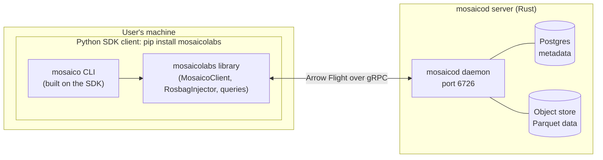
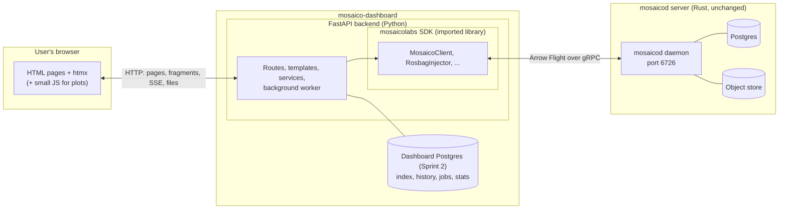
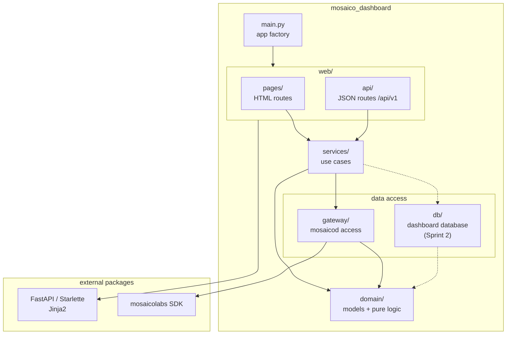
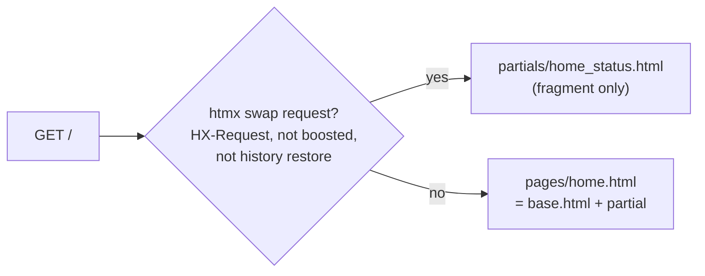
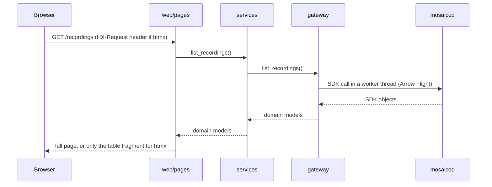

# Architecture

Living document: refined as we build. Decisions behind it are in `decisions/`.

## 1. System context

**Today (without the dashboard):** users need Python and the SDK or CLI.



**With the dashboard:** users only need a browser. The SDK runs inside the dashboard server.



- The browser never talks to mosaicod; only the SDK inside the dashboard does.
- HTML (including htmx fragments) is rendered by FastAPI with Jinja2. No frontend server or build step.
- The dashboard database is separate from mosaicod's (ADR-0004).

## 2. Folder structure

```text
mosaico-dashboard/
├── pyproject.toml            # dependencies, ruff, pyright, pytest, import-linter config
├── scripts/
│   ├── dev_setup.sh          # venv + editable SDK
│   ├── check.sh              # format, lint, import rules, types, tests
│   ├── make_demo_bags.py     # synthetic ROS 2 demo bags → demo-data/ (git-ignored)
│   └── seed_demo.py          # ingest missing demo bags into mosaicod (SDK RosbagInjector)
├── src/mosaico_dashboard/
│   ├── main.py               # create_app(settings) and the ASGI `app`
│   ├── __main__.py           # run command (D-04)
│   ├── settings.py           # configuration from env (D-04)
│   ├── logging_config.py     # logging setup (D-04)
│   ├── domain/               # dashboard models and pure logic
│   ├── gateway/              # access to mosaicod (the only SDK user)
│   ├── services/             # use cases
│   └── web/
│       ├── health.py         # GET /healthz
│       ├── rendering.py      # Jinja2 setup, render(): full page or htmx fragment
│       ├── pages/            # HTML routes (pages + htmx fragments)
│       ├── api/              # JSON routes under /api/v1
│       ├── templates/
│       │   ├── base.html     # layout: top bar, collapsible sidebar, content
│       │   ├── components.html  # UI macros (docs/ui.md)
│       │   ├── icons/        # Lucide SVG icons (vendored)
│       │   ├── pages/        # full pages, extend base.html
│       │   └── partials/     # fragments, included by pages and returned to htmx
│       └── static/
│           ├── css/app.css   # tokens, base, layout, components (docs/ui.md)
│           ├── js/app.js     # sidebar collapse
│           ├── img/          # Mosaico logo, favicon (copied from logo/ and docs/py)
│           └── vendor/       # htmx-2.0.11.min.js (pinned, no CDN)
├── tests/
│   ├── unit/                 # domain + services, no HTTP, no daemon
│   ├── web/                  # routes through TestClient
│   └── integration/          # against a running mosaicod
└── docs/
```

Added by later tasks: `db/` (Sprint 2: dashboard database tables and queries),
`worker.py` (Sprint 2: background process), `jobs/` (Sprint 5: ingestion jobs).
Folders are created by the task that first puts code in them.

| Folder | Contains | May import | Must not import |
|---|---|---|---|
| `domain/` | Dashboard models (`Recording`, `SensorStream`, …), formatting, aggregation | stdlib, pydantic, numpy | anything internal, FastAPI, SDK, database |
| `gateway/` | `MosaicoGateway` interface, SDK implementation, fake for tests. Converts SDK objects into domain models, runs blocking SDK calls in threads | `domain`, `mosaicolabs` | `services`, `web` |
| `services/` | Use cases ("list recordings", "summarise a stream"). Used by web routes and, later, the worker | `domain`, `gateway` (and later `db`) | `web`, FastAPI, SDK |
| `web/pages/` | Routes returning HTML: full page, or fragment for htmx requests | everything below, FastAPI, Jinja2 | SDK |
| `web/api/` | Routes returning JSON with Pydantic response models (OpenAPI) | everything below, FastAPI | SDK |
| `main.py` | Creates the app, wires routers and dependencies | everything | |

Settings and logging live at the package root (ADR-0007): `settings.py` reads `DASHBOARD_*`
variables from the environment or `.env`; `logging_config.py` sends dashboard, uvicorn and SDK
logs to one console handler.

### Domain vocabulary

| Mosaico (SDK) | Dashboard model | Shown as |
|---|---|---|
| Sequence | `Recording` | Recording |
| Topic | `SensorStream` | Sensor stream, labelled by its ontology tag (`IMU`, `CompressedImage`, …) as is (ADR-0031) |
| Session | `Upload` | Upload |

- Times in the domain are UTC `datetime`; the gateway converts the SDK's nanoseconds.
- A recording has two times: `uploaded_at` (sequence created in Mosaico) and
  `data_start`/`data_end` (when the robot recorded, from the topics' timestamps).
- `domain/format.py` turns sizes, times and durations into text for templates.

### Gateway

`gateway/base.py` defines `MosaicoGateway`, a Protocol (interface) of what the dashboard asks
mosaicod for. Implementations inherit it explicitly: `FakeGateway` (in memory, tests) and
`SdkGateway` (D-11).
It is **synchronous**: the SDK blocks, so services are plain functions and page routes are
`def`; FastAPI runs `def` routes in its thread pool. Errors: `GatewayUnavailable`,
`RecordingNotFound` (both `GatewayError`).

`SdkGateway` (ADR-0013) holds **one shared `MosaicoClient`**, connected on first use and closed
by the app lifespan. Every call clears the SDK's handler caches, so data is never stale.
`create_app(settings, gateway=None)` builds it from settings; tests pass `FakeGateway`. Routes
receive the gateway through the `get_gateway` dependency (`web/dependencies.py`).

## 3. Import graph

Arrows mean "imports". Rules are enforced by `import-linter` (`[tool.importlinter]` in
`pyproject.toml`, run by `scripts/check.sh`).



Contracts (all must be `KEPT`):
1. **Layers:** `web` → `services` → `gateway` → `domain`. A layer may import layers below it,
   never above.
2. **Only the gateway imports the Mosaico SDK.**
3. **Domain and services are framework-agnostic:** no FastAPI/Starlette.

## 4. HTTP conventions

| Kind | Where | URL | In OpenAPI (`/docs`) | Returns |
|---|---|---|---|---|
| Ops | `web/health.py` | `/healthz` (process alive), `/readyz` (mosaicod reachable, 200/503) | Yes, tag `ops` | JSON |
| JSON API | `web/api/` | `/api/v1/...` | Yes, tag per feature | JSON, Pydantic model as return type |
| HTML pages | `web/pages/` | `/`, `/recordings`, ... | No (`include_in_schema=False`) | Full page, or fragment for htmx |

- Every documented route has a `summary` and a tag; its return type annotation is its response
  model.
- `operationId` is the Python function name (e.g. `healthz`), so names stay readable in
  generated clients.
- Response models: a JSON route returns a domain model directly when its shape fits. Models
  that exist only for the HTTP response stay next to their route (e.g. `Health`, `Readiness` in
  `web/health.py`) and move to `web/api/schemas.py` once several `/api/v1` routes share them.
- Errors use FastAPI's standard `{"detail": ...}` until a task needs more.
- Interactive docs: `/docs` (Swagger UI) and `/redoc`; schema at `/openapi.json`.

### Pages and htmx fragments

Each page is a template in `pages/` that extends `base.html` and **includes** one or more
templates from `partials/`. A route calls `render(request, page, fragment, context)`:



- Same URL, same handler, same context for both: a fragment is exactly the part of the page
  it replaces.
- Boosted links (`hx-boost` on the nav) and history restores get the full page.
- Responses carry `Vary: HX-Request` so caches keep the two versions apart.
- Without JavaScript, forms and links are normal GET requests and get full pages.
- Static files use plain `/static/...` paths (no absolute URLs), so they work behind a proxy.
- Templates format values with Jinja filters registered in `rendering.py` from
  `domain/format.py`: `{{ r.size_bytes | bytes }}`, `| duration`, `| datetime`.

## 5. Testing conventions

| Folder | What | Needs |
|---|---|---|
| `tests/unit/` | domain, services, gateways in isolation | nothing |
| `tests/web/` | routes through `TestClient`, app built with `FakeGateway` | nothing |
| `tests/integration/` | `SdkGateway` against real data, marked `integration` | mosaicod on `localhost:6726`, otherwise skipped (reason printed) |

- Use `FakeGateway` (a real in-memory implementation), not mocks. `FakeGateway(available=False)`
  simulates a down daemon.
- Shared setup lives in `conftest.py` fixtures: `tests/conftest.py` (every test runs in an empty
  temp directory, so no `.env` is read, and the root logger is restored), `tests/web/conftest.py`
  (`gateway`, `client`, `client_daemon_down`).
- One behaviour per test, named after it; `parametrize` for tables of cases.
- Tests must pass in any order (checked by running files in reverse order).
- `bash ./scripts/check.sh` is the only entry point, locally and in CI.

## 6. Request flow (example: recordings page)


