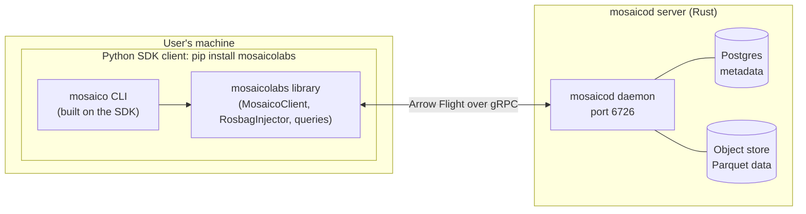
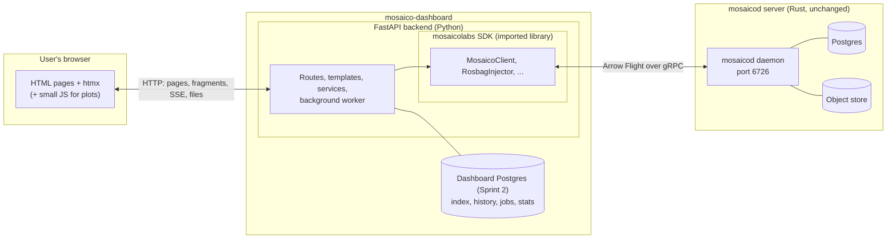
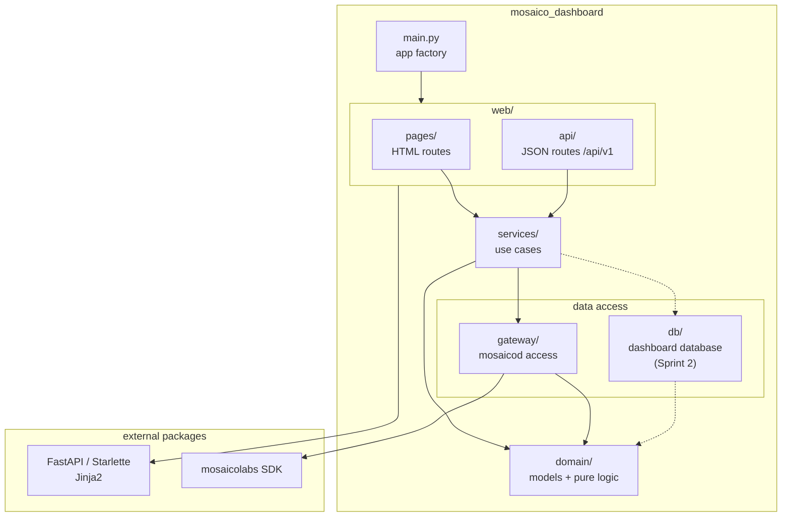
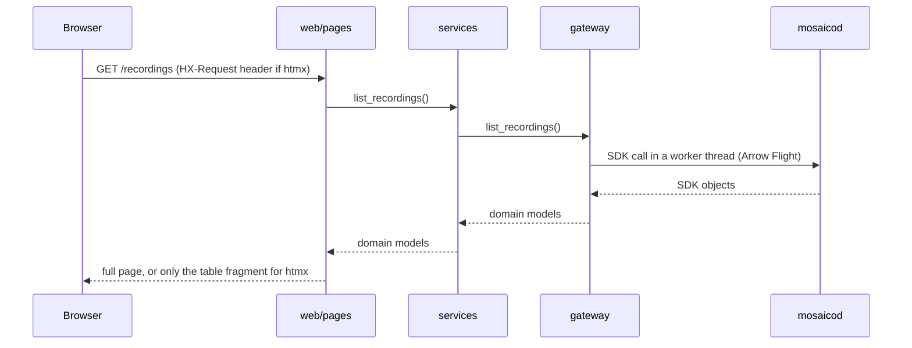

# Architecture

Living document: refined as we build. Decisions behind it are in `decisions/`.

## 1. System context

**Today (without the dashboard):** users need Python and the SDK or CLI.



**With the dashboard:** users only need a browser. The SDK runs inside the dashboard server.



- The browser never talks to mosaicod; only the SDK inside the dashboard does.
- HTML (including htmx fragments) is rendered by FastAPI with Jinja2. No frontend server or build step.
- The dashboard database is separate from mosaicod's (ADR-0004).

## 2. Folder structure

```text
mosaico-dashboard/
├── pyproject.toml            # dependencies, ruff, pyright, pytest, import-linter config
├── scripts/
│   ├── dev_setup.sh          # venv + editable SDK
│   └── check.sh              # format, lint, import rules, types, tests
├── src/mosaico_dashboard/
│   ├── main.py               # FastAPI app (app factory in D-05)
│   ├── __main__.py           # run command (D-04)
│   ├── settings.py           # configuration from env (D-04)
│   ├── logging_config.py     # logging setup (D-04)
│   ├── domain/               # dashboard models and pure logic
│   ├── gateway/              # access to mosaicod (the only SDK user)
│   ├── services/             # use cases
│   └── web/
│       ├── pages/            # HTML routes (pages + htmx fragments)
│       ├── api/              # JSON routes under /api/v1
│       ├── templates/        # Jinja2 templates (D-06)
│       └── static/           # CSS, JS, vendored htmx (D-06)
├── tests/
│   ├── unit/                 # domain + services, no HTTP, no daemon
│   ├── web/                  # routes through TestClient
│   └── integration/          # against a running mosaicod
└── docs/
```

Added by later tasks: `db/` (Sprint 2: dashboard database tables and queries),
`worker.py` (Sprint 2: background process), `jobs/` (Sprint 5: ingestion jobs).
Folders are created by the task that first puts code in them.

| Folder | Contains | May import | Must not import |
|---|---|---|---|
| `domain/` | Dashboard models (`Recording`, `SensorStream`, …), formatting, vocabulary, aggregation | stdlib, pydantic, numpy | anything internal, FastAPI, SDK, database |
| `gateway/` | `MosaicoGateway` interface, SDK implementation, fake for tests. Converts SDK objects into domain models, runs blocking SDK calls in threads | `domain`, `mosaicolabs` | `services`, `web` |
| `services/` | Use cases ("list recordings", "summarise a stream"). Used by web routes and, later, the worker | `domain`, `gateway` (and later `db`) | `web`, FastAPI, SDK |
| `web/pages/` | Routes returning HTML: full page, or fragment for htmx requests | everything below, FastAPI, Jinja2 | SDK |
| `web/api/` | Routes returning JSON with Pydantic response models (OpenAPI) | everything below, FastAPI | SDK |
| `main.py` | Creates the app, wires routers and dependencies | everything | |

Settings and logging live at the package root (ADR-0007): `settings.py` reads `DASHBOARD_*`
variables from the environment or `.env`; `logging_config.py` sends dashboard, uvicorn and SDK
logs to one console handler.

## 3. Import graph

Arrows mean "imports". Rules are enforced by `import-linter` (`[tool.importlinter]` in
`pyproject.toml`, run by `scripts/check.sh`).



Contracts (all must be `KEPT`):
1. **Layers:** `web` → `services` → `gateway` → `domain`. A layer may import layers below it,
   never above.
2. **Only the gateway imports the Mosaico SDK.**
3. **Domain and services are framework-agnostic:** no FastAPI/Starlette.

## 4. Request flow (example: recordings page)


