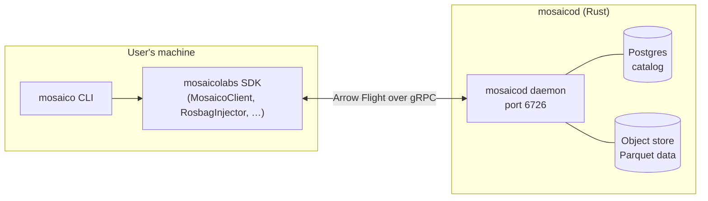
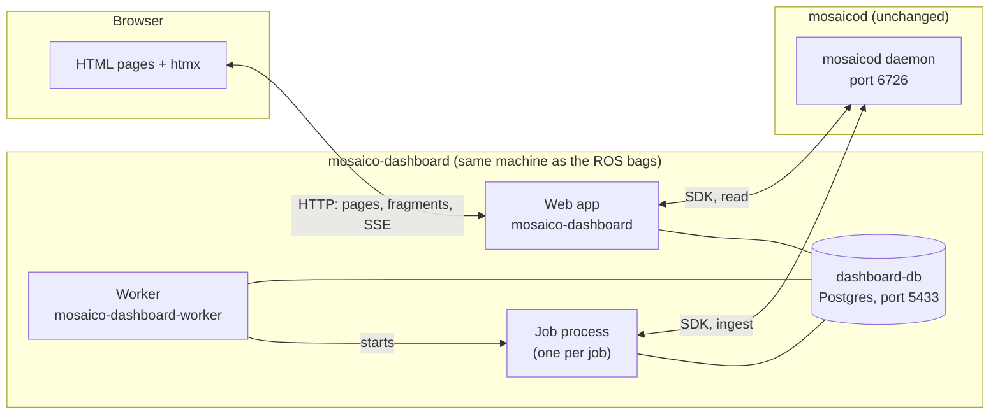
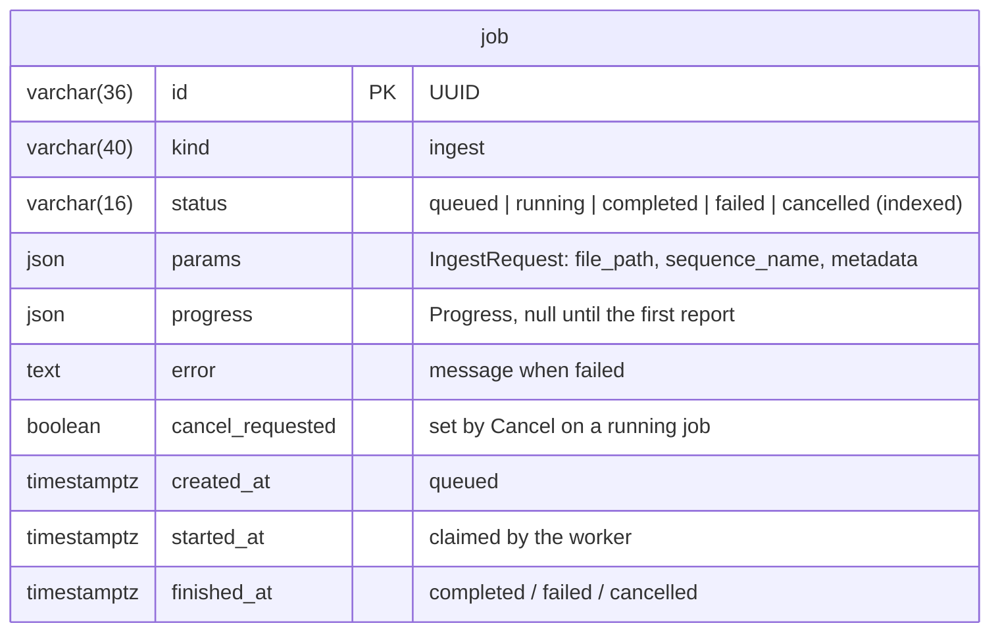
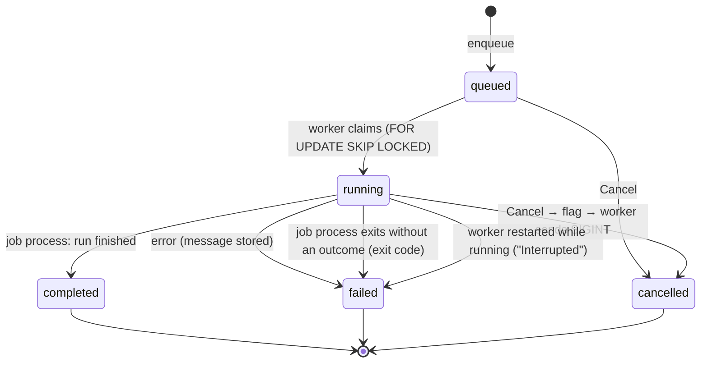
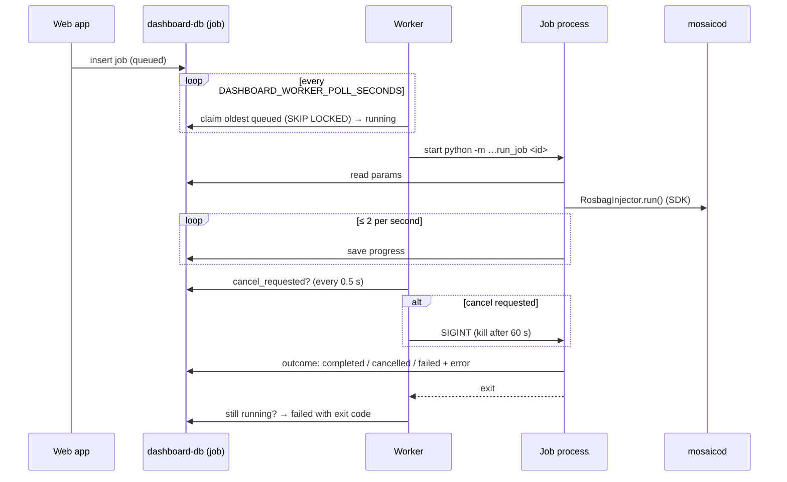
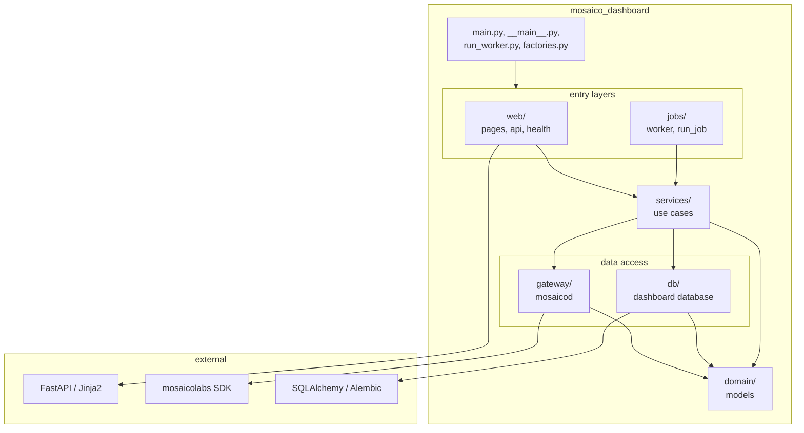
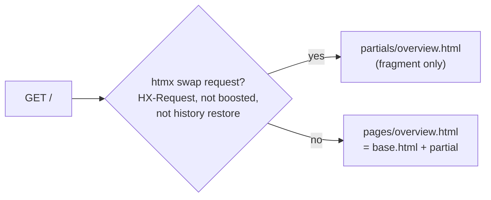
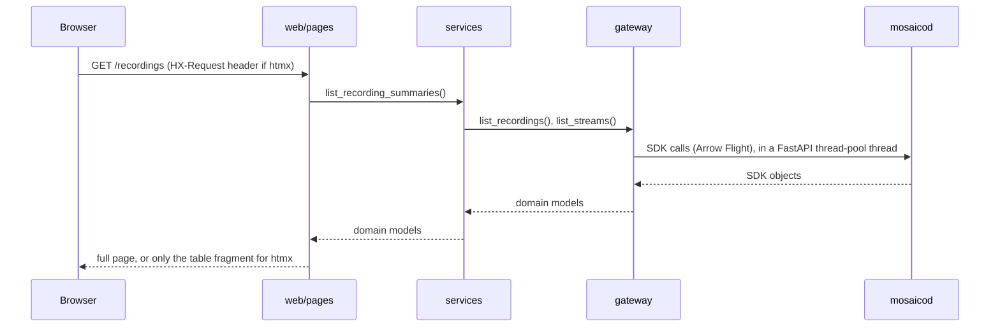

# Architecture

Living document, kept in step with the code: every task that changes structure, processes or
data updates it. Decisions behind it are in `decisions/` (ADRs).

## 1. System context

**Without the dashboard:** users need Python and the SDK (or the `mosaico` CLI, read only).



**With the dashboard:** users only need a browser. The SDK runs inside the dashboard's processes.



- The browser never talks to mosaicod; only the SDK inside the dashboard does.
- The dashboard database is the dashboard's own, separate from mosaicod's (ADR-0004); the
  dashboard never touches mosaicod's database.
- HTML (including htmx fragments) is rendered by FastAPI with Jinja2. No frontend build step.

## 2. Processes

| Process | Command (dev) / container | Started by | Lifetime | Connections |
| --- | --- | --- | --- | --- |
| Web app | `poetry run mosaico-dashboard` / `dashboard` | the user (or compose) | long-running | one shared SDK client to mosaicod (read), engine to dashboard-db |
| Worker | `poetry run mosaico-dashboard-worker` / `dashboard-worker` | the user (or compose), independently of the web app | long-running, idle between jobs | dashboard-db only |
| Job process | `python -m mosaico_dashboard.jobs.run_job <job id>` | the worker, one per job | one job, then exits | its own SDK connection (ingest) and engine, closed at the end |

- Web app and worker never call each other: they only share the `job` table.
- Both apply database migrations on start (`DASHBOARD_MIGRATE_ON_START`), under a Postgres
  advisory lock, so they can start in any order. If the database is down, both start anyway:
  the web app keeps serving the catalog pages (they only need mosaicod), the worker retries.
- The job process runs in its own session: a Ctrl-C in the worker's terminal reaches it only
  through the worker (ADR-0035).

## 3. Dashboard database

PostgreSQL 18 (`dashboard-db`), accessed with SQLAlchemy Core and psycopg 3, synchronous
(ADR-0034). Tables are defined in `db/tables.py`; schema changes are Alembic migrations in
`db/migrations/versions/` (one file per change, generated with
`poetry run alembic revision --autogenerate -m "…"`, reviewed, committed).

| Revision | Change |
| --- | --- |
| `0d9a3c5e7b21` | baseline (empty schema) |
| `b0a46eb62c9d` | table `job` |

### Tables



`progress` holds the latest `Progress` (domain model), written by the job process from the SDK
progress callback (ADR-0033) at most twice a second:

```json
{"done": 5453, "total": 18990, "finished": false,
 "topics": [{"name": "/imu/data", "done": 5163, "total": 18000, "status": null}, …]}
```

### Job lifecycle



## 4. Ingestion flow



The Ingest page (`/ingest`) lists the bags in `DASHBOARD_INGEST_DIR`, shows the options for the
selected one (D-20) and runs a dry run in the web process (`POST /ingest/dry-run`, D-21);
starting the job and live progress follow (D-22).

Creating an SDK injector replaces the SDK logger's handlers with its own (Rich, stderr). The
web process hands them back right after (`logging_config.route_sdk_logs_to_root`); the job
process keeps the SDK's set-up, its output goes to the worker's terminal.

## 5. Folder structure

```text
mosaico-dashboard/
├── pyproject.toml            # dependencies, scripts, ruff, pyright, pytest, import-linter
├── alembic.ini               # for `alembic revision` from the command line
├── scripts/
│   ├── dev_setup.sh          # venv + editable SDK
│   ├── check.sh              # format, lint, import rules, types, tests
│   ├── make_demo_bags.py     # synthetic ROS 2 demo bags → demo-data/ (git-ignored)
│   └── seed_demo.py          # ingest missing demo bags into mosaicod
├── src/mosaico_dashboard/
│   ├── main.py               # create_app(settings, gateway, engine) and the ASGI `app`
│   ├── __main__.py           # web command: migrate, then uvicorn
│   ├── run_worker.py         # worker command: migrate, then the worker loop
│   ├── settings.py           # configuration from env / .env (DASHBOARD_*)
│   ├── logging_config.py     # one console handler for dashboard, uvicorn and SDK logs
│   ├── factories.py          # build gateway and engine from settings (all processes)
│   ├── domain/               # models (Recording, Job, Progress, …), formatting
│   ├── gateway/              # mosaicod access: base (Protocol), sdk, fake; files (bag listing)
│   ├── db/
│   │   ├── engine.py         # engine (2 s connect timeout), ping
│   │   ├── tables.py         # table definitions (SQLAlchemy Core)
│   │   ├── jobs.py           # job queue: enqueue, claim, progress, finish, cancel
│   │   ├── common.py         # helpers (UTC times from SQLite)
│   │   ├── migrate.py        # upgrade_to_head under an advisory lock
│   │   └── migrations/       # Alembic: env.py, script.py.mako, versions/
│   ├── jobs/
│   │   ├── worker.py         # Worker: claim, start the job process, cancel, outcome
│   │   └── run_job.py        # job process entry point
│   ├── services/             # use cases: overview, recordings, status, ingestion
│   └── web/
│       ├── health.py         # /healthz, /readyz
│       ├── dependencies.py   # get_gateway, get_engine
│       ├── rendering.py      # Jinja2 setup, filters, render(): page or htmx fragment
│       ├── pages/            # HTML routes: overview, recordings, ingest, export, status
│       ├── api/              # JSON routes under /api/v1 (none yet)
│       ├── templates/        # base.html, components.html, icons/, pages/, partials/
│       └── static/           # css/app.css, js/app.js, img/, vendor/ (htmx)
├── tests/
│   ├── unit/                 # domain, services, db on SQLite, worker with child processes
│   ├── web/                  # routes through TestClient
│   ├── database/             # Postgres-only behaviour, marker `database`
│   └── integration/          # against a running mosaicod, marker `integration`
└── docs/                     # this file, ui.md, BACKLOG, DEVLOG, plans/, decisions/ (local)
```

| Folder | Contains | May import | Must not import |
| --- | --- | --- | --- |
| `domain/` | Dashboard models, formatting | stdlib, pydantic | anything internal, FastAPI, SDK, SQLAlchemy |
| `gateway/` | `MosaicoGateway` Protocol, SDK implementation, fake for tests; converts SDK objects into domain models | `domain`, `mosaicolabs` | `db`, `services`, `web`, `jobs` |
| `db/` | Engine, tables, repositories, migrations | `domain`, SQLAlchemy, Alembic | `gateway`, `services`, `web`, `jobs`, SDK |
| `services/` | Use cases, used by web routes and the job process | `domain`, `gateway`, `db` | `web`, `jobs`, FastAPI, SDK |
| `web/` | HTML pages, JSON API, templates, static files | everything below, FastAPI, Jinja2 | `jobs`, SDK |
| `jobs/` | Worker loop and job process entry | everything below | `web`, SDK |
| package root | `main.py`, `__main__.py`, `run_worker.py`, `factories.py`, settings, logging | everything | |

## 6. Import graph

Arrows mean "imports". Rules are enforced by `import-linter` (`[tool.importlinter]` in
`pyproject.toml`, run by `scripts/check.sh`).



Contracts (all must be `KEPT`):
1. **Layers:** (`web` | `jobs`) → `services` → (`gateway` | `db`) → `domain`. A layer may
   import layers below it, never above; layers on the same level don't import each other.
2. **Only the gateway imports the Mosaico SDK** (checked for `domain`, `services`, `web`, `db`).
3. **Domain and services are framework-agnostic:** no FastAPI / Starlette.

### Domain vocabulary

| Mosaico (SDK) | Dashboard model | Shown as |
| --- | --- | --- |
| Sequence | `Recording` | Recording |
| Topic | `SensorStream` | Stream, labelled by its ontology tag (`IMU`, `CompressedImage`, …) as is (ADR-0031) |
| Session | `Upload` | Upload |
| Injector run | `Job` (kind `ingest`) + `Progress` | Ingestion |

- Times in the domain are UTC `datetime`; the gateway converts the SDK's nanoseconds.
- A recording has two times: `uploaded_at` (created in Mosaico) and `data_start` / `data_end`
  (when the robot recorded).

### Gateway

`gateway/base.py` defines `MosaicoGateway`, a Protocol of what the dashboard needs from
mosaicod: `check_connection`, `list_recordings`, `get_recording`, `list_streams`,
`list_bag_files` (local ROS bags, listed and named by the SDK watchdog's `LocalFileSource` and
`sequence_name_from_fileref`, `gateway/files.py`), `dry_run`, `ingest`, `close`. Implementations inherit it explicitly: `SdkGateway` and `FakeGateway` (in memory,
tests).

- **Synchronous**: the SDK blocks; services are plain functions, page routes are `def`, and
  FastAPI runs them in its thread pool (ADR-0012).
- `SdkGateway` holds one shared `MosaicoClient`, connected on first use, caches cleared on
  every call (ADR-0013). `ingest()` runs `RosbagInjector` with the progress callback and
  converts the SDK's `ProgressSnapshot` into the domain `Progress`.
- Errors: `GatewayUnavailable`, `RecordingNotFound` (both `GatewayError`); ingestion errors
  from the SDK are passed on with their message.

## 7. HTTP conventions

| Kind | Where | URL | In OpenAPI (`/docs`) | Returns |
| --- | --- | --- | --- | --- |
| Ops | `web/health.py` | `/healthz` (process alive), `/readyz` (mosaicod and database, each reported; 503 if either is down) | Yes, tag `ops` | JSON |
| JSON API | `web/api/` | `/api/v1/...` | Yes, tag per feature | JSON, Pydantic model as return type |
| HTML pages | `web/pages/` | `/`, `/recordings`, `/ingest` (+ `POST /ingest/dry-run`, fragment), `/export`, `/status` | No | Full page, or fragment for htmx |

- Every documented route has a `summary` and a tag; its return type annotation is its response
  model. `operationId` is the Python function name.
- Errors use FastAPI's standard `{"detail": ...}` until a task needs more.
- Interactive docs: `/docs` (Swagger UI) and `/redoc`; schema at `/openapi.json`.

### Pages and htmx fragments

Each page is a template in `pages/` that extends `base.html` and includes templates from
`partials/`. A route calls `render(request, page, fragment, context)`:



- Same URL, same handler, same context for both: a fragment is exactly the part of the page
  it replaces. Boosted links and history restores get the full page.
- Responses carry `Vary: HX-Request`. Static files use relative `/static/...` paths.
- Templates format values with Jinja filters from `domain/format.py` (`| bytes`, `| duration`,
  `| datetime`, …); UI rules are in `ui.md`.

### Request flow (example: recordings page)



## 8. Testing conventions

| Folder | What | Needs |
| --- | --- | --- |
| `tests/unit/` | domain, services, gateways, `db/` on in-memory SQLite, the worker with real child processes on a SQLite file | nothing |
| `tests/web/` | routes through `TestClient`, app built with `FakeGateway` and in-memory SQLite | nothing |
| `tests/database/` | Postgres-only behaviour (migrations, advisory lock, `SKIP LOCKED`), marker `database`, on a fresh `dashboard_test` database | dashboard-db or `DASHBOARD_TEST_DATABASE_URL`, otherwise skipped |
| `tests/integration/` | `SdkGateway` against real data, marker `integration` | mosaicod on `localhost:6726`, otherwise skipped |

- `FakeGateway` (a real in-memory implementation), not mocks; `FakeGateway(available=False)`
  simulates a down daemon.
- Fixtures: `tests/conftest.py` (empty temp directory per test so no `.env` is read, logger
  restored, `sqlite_engine`, `sqlite_file`), `tests/web/conftest.py` (`gateway`, `client`,
  `client_daemon_down`, `client_database_down`), `tests/database/conftest.py`
  (`postgres_url`, `postgres_engine`).
- One behaviour per test, named after it; tests pass in any order.
- `bash ./scripts/check.sh` is the only entry point, locally and in CI (CI adds a Postgres
  service).
