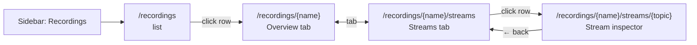
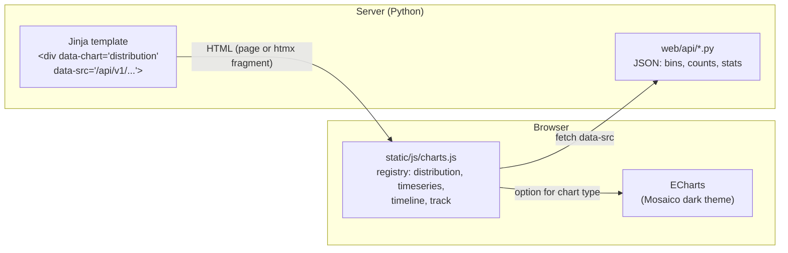
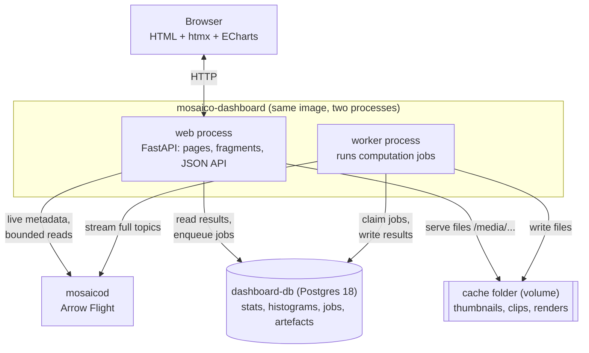
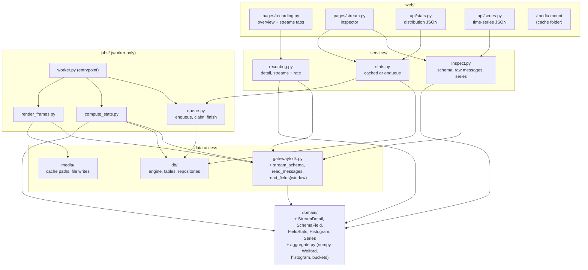
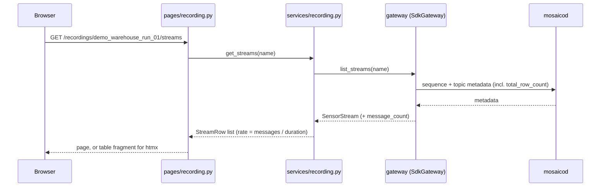
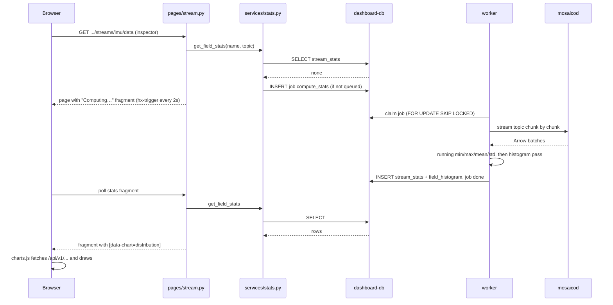
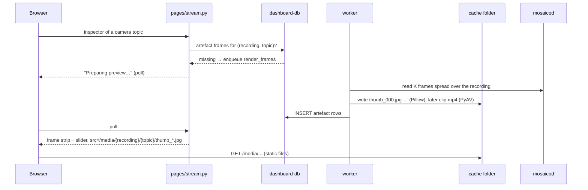
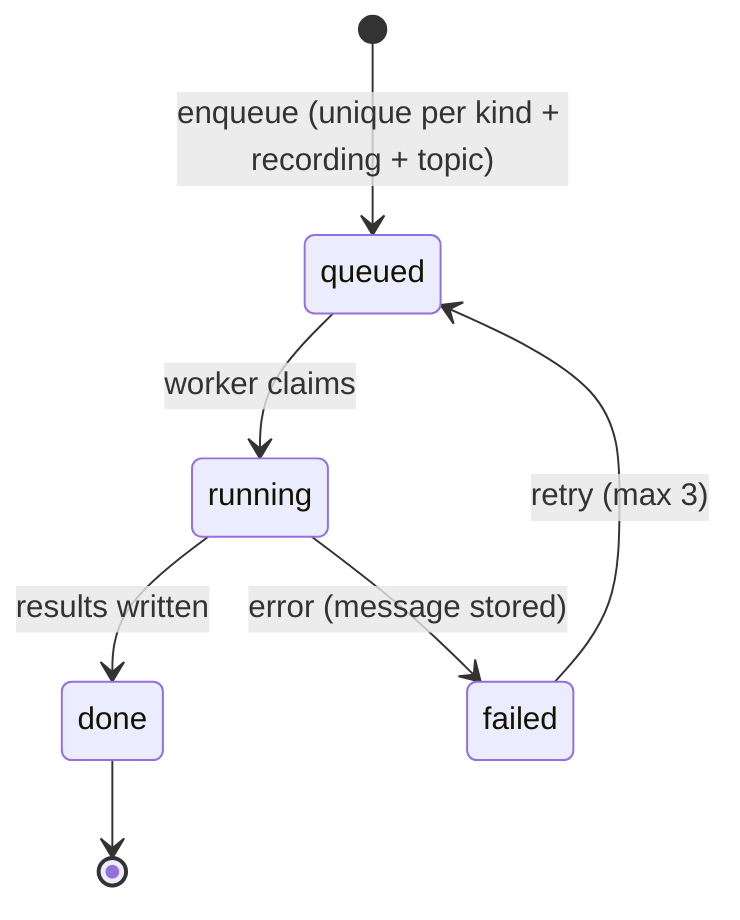
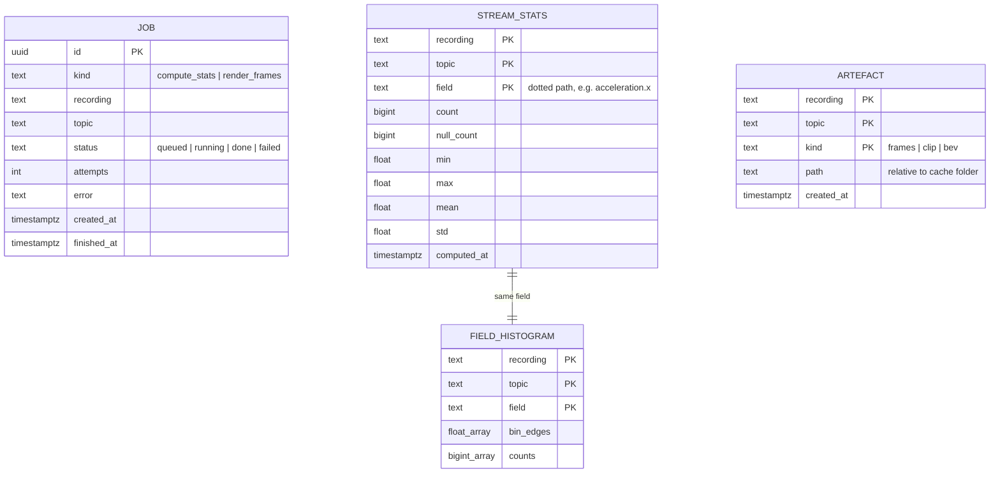
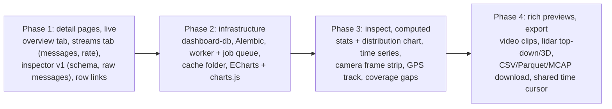

# Plan: recording detail, stream inspector, charts, computed data

Status: proposal (2026-10-18). Agreed parts become backlog tasks; diagrams move to
`architecture.md` as they are implemented.

## 1. Navigation

- Every view has its own URL (shareable, back button). Tabs are boosted links.
- The topic is the **last** path segment (`{topic:path}`, topics contain `/`). JSON endpoints
  take the topic as a query parameter (`?topic=/imu/data`).
- No recording list inside the sidebar (does not scale); "Recordings" stays highlighted.

## 2. Views

| View | For | Content |
|---|---|---|
| Overview tab | everyone | tiles (recorded, duration, size, streams, uploaded), coverage, sensors by category, metadata (readable, nested values collapsible), uploads |
| Streams tab | analysts, developers | per topic: path, sensor label + tag, ROS type, messages, rate, duration, size |
| Stream inspector | developers | header + SDK snippet, schema tree with types, **interactive charts** (distribution per field, time series), preview by sensor type, first N raw messages |

### Interactive charts (W&B-style, for a static dataset)

| Chart | Shows | Interaction |
|---|---|---|
| Distribution (per numeric field) | real histogram; lines for mean, min, max; shaded ±1σ band; optional fitted normal curve | hover → bin range, count, share; field picker |
| Time series (per field) | value over time, downsampled to screen width (mean line + min/max band) | crosshair with values at cursor; drag/scroll to zoom → re-fetch window in full detail |
| Coverage timeline | one bar per stream over the recording; gaps (phase 3) | hover → stream, start, end, gap ranges |
| Storage bars (overview) | already CSS; can move to ECharts later | hover → exact bytes |
| GPS track / point cloud | track on lat/lon plane; lidar top-down or 3D (`echarts-gl`) | zoom, hover |

Histogram, not a drawn bell curve: sensor data is often multi-modal or clipped; a curve drawn from
mean and std would misrepresent it.

## 3. Charting: Apache ECharts 6.1.0, the one library

- One library for every chart (distribution, time series, timeline, bars, scatter, 3D add-on);
  vendored like htmx (`static/vendor/echarts-6.1.0.min.js`, ~1 MB, ~330 KB gzipped, cached by
  the browser); `echarts-gl` only on point-cloud pages. Apache-2.0.
- Rejected: uPlot (only lines/bars → would need a second library), Plotly (~3.5 MB, slow DOM),
  Chart.js (weak on large data and ranges).
- **Server sends data, not chart code.** The backend returns plain JSON (bins, counts, stats,
  series); one JS module turns it into an ECharts option per chart type. Swapping the library
  later touches only that module.

`charts.js` initialises every `[data-chart]` element on page load **and** after every htmx swap
(`htmx:afterSettle`), and disposes charts that htmx removes. Adding a chart type = one function
in the registry + one API endpoint.

## 4. System: processes and storage

- Web never reads a whole topic; worker never serves HTTP.
- Compose: `dashboard-db` (own volume `dashboard-pg-data`, host port 5433) and `dashboard-cache`
  volume; in development the app and worker run from the venv, cache in `mosaico-dashboard/.cache/`.

## 5. Code decomposition (new files in **bold**)

Import rules (extend `import-linter`): `web → services → (gateway | db | media) → domain`;
`jobs` may import `services`, `gateway`, `db`, `media`, `domain`, never `web`; only `gateway`
imports the SDK; `domain` stays pure (numpy allowed).

## 6. Flows

### 6.1 Overview / Streams tab (live, phase 1)

### 6.2 Statistics: cache miss → job → result (phase 3)

Next visit: the first `SELECT` hits and the chart appears immediately. Results never expire
(immutable data); they are deleted with the recording.

### 6.3 Camera frames / video (phase 3–4)

### 6.4 Job lifecycle

## 7. Dashboard database (phase 2–3)

- Keys are (recording, topic[, field]); no foreign keys to mosaicod (separate system).
- When a recording disappears from mosaicod (catalog sync), its rows and cache folder are deleted.
- Cache folder layout: `{recording}/{topic-slug}/thumb_000.jpg`, `clip.mp4`, `bev.png`.

## 8. Phases and order

The catalog index (fast list and filters) and storage history reuse the phase-2 infrastructure.
